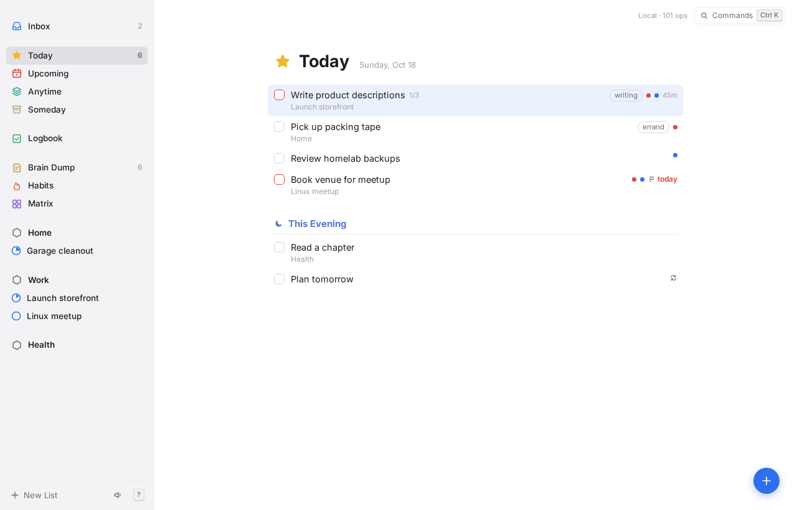
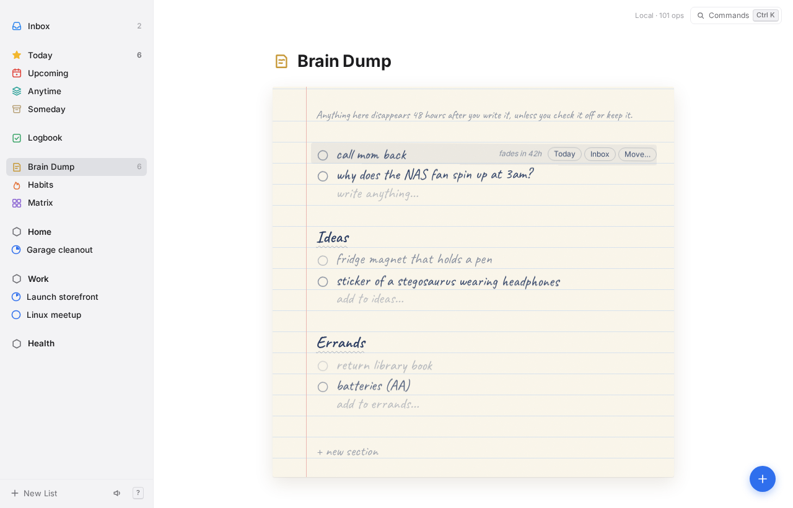
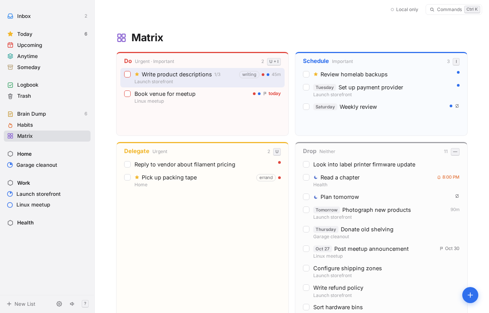
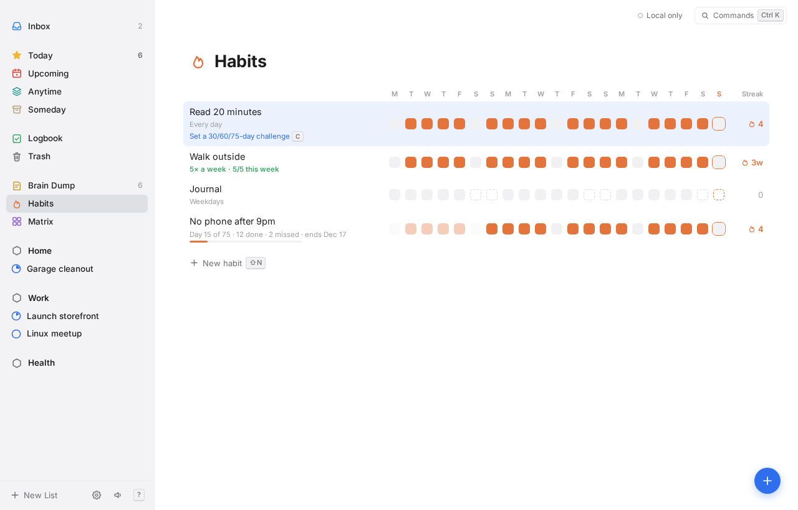
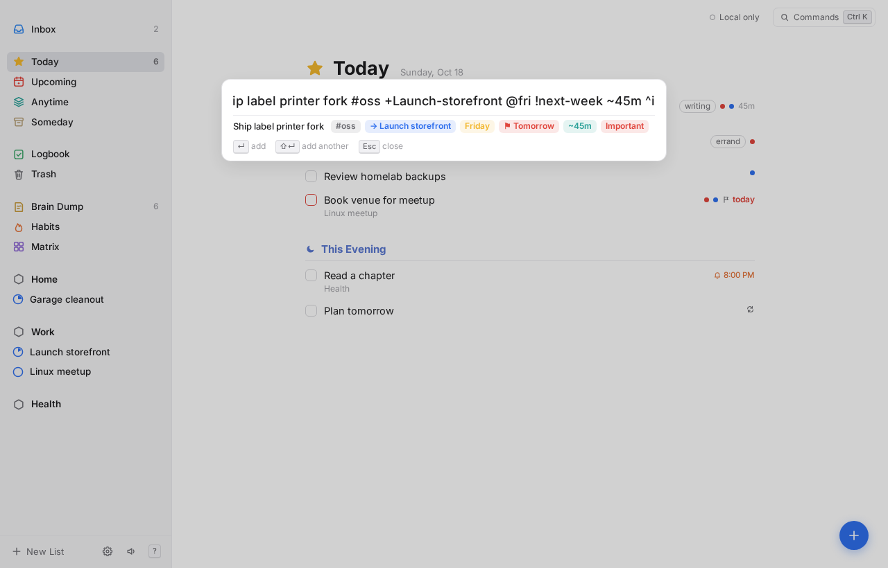

<p align="center">
  
</p>

<h1 align="center">OpenThings</h1>

<p align="center">
  <b>A self-hosted, local-first task manager with a calm, keyboard-first design.</b><br>
  Plan your day with Today, Upcoming and Areas, then focus with a built-in Pomodoro, habits, reminders and an Eisenhower matrix.
  Capture anything in a brain dump that tidies itself after 48 hours. Runs in your browser on desktop and phone, from one Docker container you host.
</p>

<p align="center">
  <a href="https://spuder.github.io/OpenThings/app/"></a>
  <a href="https://github.com/spuder/OpenThings/pkgs/container/openthings"></a>
  <a href="#self-hosting"></a>
</p>

<p align="center">
  <a href="https://spuder.github.io/OpenThings/">Website</a> ·
  <a href="https://spuder.github.io/OpenThings/app/">Try it in the browser</a> ·
  <a href="#self-hosting">Self-hosting</a> ·
  <a href="#features">Features</a> ·
  <a href="#roadmap">Roadmap</a> ·
  <a href="docs/sync.md">Sync protocol</a> ·
  <a href="AGENTS.md">Contributing</a> ·
  <a href="https://github.com/spuder/OpenThings/issues">Issues</a>
</p>

<p align="center">
  <a href="https://github.com/spuder/OpenThings/actions/workflows/container.yml"></a>
  <a href="https://github.com/spuder/OpenThings/pkgs/container/openthings"></a>
  <a href="https://github.com/spuder/OpenThings/pkgs/container/openthings"></a>
  <a href="LICENSE"></a>
  <a href="https://github.com/spuder/OpenThings/commits/main"></a>
  <a href="https://github.com/spuder/OpenThings/issues"></a>
  <a href="https://github.com/spuder/OpenThings/stargazers"></a>
</p>

<p align="center">
  
</p>

> **Status: proof of concept.** Works in desktop and phone browsers and installs to the home screen. Data lives in your browser (SQLite in IndexedDB); the sync client is built, the sync server and native apps are not yet.
>
> Inspired by the principles of [Things 3](https://culturedcode.com/things/) and [Super Productivity](https://github.com/super-productivity/super-productivity), built independently and not affiliated with either. See [AGENTS.md](AGENTS.md) for the clean-room and licensing rules.

| Brain Dump | Matrix |
| --- | --- |
|  |  |
| **Habits** | **Quick add** |
|  |  |

## Features

- **Lists:** Inbox, Today with This Evening, Upcoming, Anytime, Someday, Logbook.
- **Structure:** Areas of responsibility → Projects → Headings → To-dos, with notes, checklists, tags, deadlines and repeats.
- **Brain Dump:** a paper-styled scratch list. Unchecked items fade over 48 hours, then are deleted for good. Check them off, or keep them by moving to the Inbox, Today or any list. Supports sections.
- **Habits** with a 21-day grid (7 on phones) and streaks. Optional **challenges** of a fixed length: 30, 60, 75 days or any number, with day count, missed days and end date. Press `C` on a habit, or name it `Cold shower 75d`. **Schedules:** every day, weekdays, specific days, or N times a week on any days (`W` on a habit, or name it `Gym 5x` / `Journal weekdays`); streaks and missed days follow the schedule.
- **Matrix:** Eisenhower quadrants from urgent / important flags.
- **Focus mode:** select a to-do and press `F` for a full-screen Pomodoro (15/25/50 min) with breaks, session count, its checklist and a Complete button. It keeps running if you close it; a pill in the header takes you back.
- **Time tracking** per task.
- **Completion chimes**, synthesized in the browser (toggle with ⇧M).
- **Reminders:** press `A` on a to-do or type `%9am`, `%in30m`, `%fri-9am` in quick add. Due reminders show a system notification, play a chime and appear in the app while OpenThings is open (tab or installed app); missed ones fire on next open. Settings shows permission and upcoming reminders.
- **Areas and projects** can be renamed, moved or deleted from the ⋯ button or right-click in the sidebar (or `⇧L`).
- **Appearance:** System, Light or Dark in Settings, or `⇧D` to toggle. On desktop, `⇧T` opens a theme switcher with all 23 [Omarchy](https://omarchy.org) themes (Tokyo Night, Catppuccin, Gruvbox, Nord, Rose Pine…), previewed live as you move through them.
- **Trash:** deleted to-dos can be restored for 30 days, then they're purged.
- **Sync status** on every screen, and a **Settings** page: sync setup (see [docs/sync.md](docs/sync.md)), notifications, and the planned REST API and MCP endpoints with ready-to-copy config.
- **Mobile:** responsive layout, list drawer, tap to open tasks, larger touch targets, installable as a home-screen app.
- **Quick add** with short syntax (below), from anywhere with `Q`.
- **Quick Find** (`/` or `Ctrl/⌘ F`): recent lists with counts, then search lists, projects, areas, `#tags` and to-dos as you type.
- **Bottom toolbar** with New to-do, When, Move and Quick Find; hide the sidebar with `Ctrl/⌘ /`.
- **Command palette** (`Ctrl/⌘ K`) and a shortcut sheet (`?`).
- **Local-first data:** SQLite (WASM) with an op log of every change, ready for a sync server. JSON export.
- Light and dark mode.

## Quick add syntax

| Token | Meaning |
| --- | --- |
| `#tag` | Tag |
| `+Project` | Project or area (hyphens for spaces: `+Launch-storefront`) |
| `@today` `@tonight` `@tomorrow` `@someday` `@inbox` | When |
| `@fri` `@in3d` `@2w` `@next-week` `@nov-3` `@2026-11-02` | When, by weekday, offset or date |
| `@dump` `@dump/Ideas` | Brain dump, optional section |
| `!fri` | Deadline |
| `%9am` `%18:30` `%in30m` `%fri-9am` | Reminder |
| `~30m` `~1h30m` | Time estimate |
| `*daily` `*weekly` `*weekdays` `*2w` | Repeat |
| `^u` `^i` `^ui` | Urgent / important |
| `… // notes` | Everything after `//` becomes notes |

Example: `Photograph products +Launch-storefront @fri !next-week ~45m #shop ^i`

## Keyboard

| Keys | Action |
| --- | --- |
| `Q` / `N` | Quick add |
| `B` | Add to brain dump |
| `Alt+1…9` or `G` then `I T U A S L D H M` | Inbox, Today, Upcoming, Anytime, Someday, Logbook, Dump, Habits, Matrix |
| `J` / `K` | Move selection |
| `Enter` | Open / close task |
| `X` | Complete |
| `T` `E` `R` `S` | Today, This Evening, Tomorrow, Someday |
| `W` / `D` / `A` | When… / Deadline… / Reminder… |
| `M` | Move to list |
| `#` | Tag |
| `U` / `I` | Urgent / important |
| `F` | Focus mode (Pomodoro on the selected to-do) |
| `P` / `⇧P` | Timer / quick Pomodoro |
| `⇧L` | Rename / move / delete the current area or project |
| `⇧D` | Toggle dark mode |
| `⇧T` | Theme switcher (Omarchy themes, desktop) |
| `Alt+↑` / `Alt+↓` | Reorder |
| `⌫` | Move to Trash |
| `Alt+0` / `G X` | Trash (`⇧R` restore) |
| `C` | Habit challenge length |
| `Ctrl/⌘ ,` | Settings |
| `/` or `Ctrl/⌘ F` | Quick Find |
| `Ctrl/⌘ /` | Show / hide sidebar |
| `Ctrl/⌘ K` | Command palette |
| `?` | All shortcuts |

## Development

```sh
npm install
npm run dev     # http://localhost:5173
npm test
npm run check
npm run build
```

To start over with the demo data, run **Reset demo data** from the command palette.

## Self-hosting

Images are published to GHCR by GitHub Actions on every push to `main` (`latest`, `sha-<short>`) and on `v*` tags (`1.2.3`, `1.2`), for `linux/amd64` and `linux/arm64`.

```sh
curl -O https://raw.githubusercontent.com/spuder/OpenThings/main/compose.yaml
docker compose up -d
```

`compose.yaml` pulls `ghcr.io/spuder/openthings:latest` and carries [DockTail](https://github.com/marvinvr/docktail) labels, so with DockTail running on the host the app appears at `https://openthings.<tailnet>.ts.net` with no published ports. Without DockTail, add `ports: ["8080:8080"]`. To build locally: `docker build -t openthings .`

The image is a static build served by nginx. Until the sync server exists, **each browser keeps its own data** in IndexedDB, so hosting it centrally gives every device the same app but not the same tasks. Use **Export JSON backup** (`Ctrl/⌘ ⇧ E`) to save a copy.

## Roadmap

1. **Sync server:** TypeScript on Bun, SQLite, one Docker container on Tailscale. Serves this web app, and clients push and pull the op log. Replaces the nginx image.
2. **REST API** on the server: tasks, projects, areas, habits, brain dump, time entries. Quick add accepts the same syntax as the app.
3. **MCP server** on the same container, so AI assistants can read and manage tasks (list Today, add with quick-add syntax, complete, move, start timers). It's a thin layer over the REST API and goes through the same op log.
4. **Calendar time-blocking:** drag tasks onto a day timeline; blocks sync to a CalDAV calendar (iCloud, Radicale, Nextcloud, etc.) from the server, and existing events show as busy time.
5. **Desktop:** Tauri shell with a global quick-add hotkey (macOS and Omarchy/Hyprland).
6. **Mobile:** Capacitor iOS and Android, plus native widgets, Shortcuts and share sheet.
7. Things 3 import, CLI.

## License

[MIT](LICENSE). Third-party licenses: [THIRD_PARTY_NOTICES.md](THIRD_PARTY_NOTICES.md).
