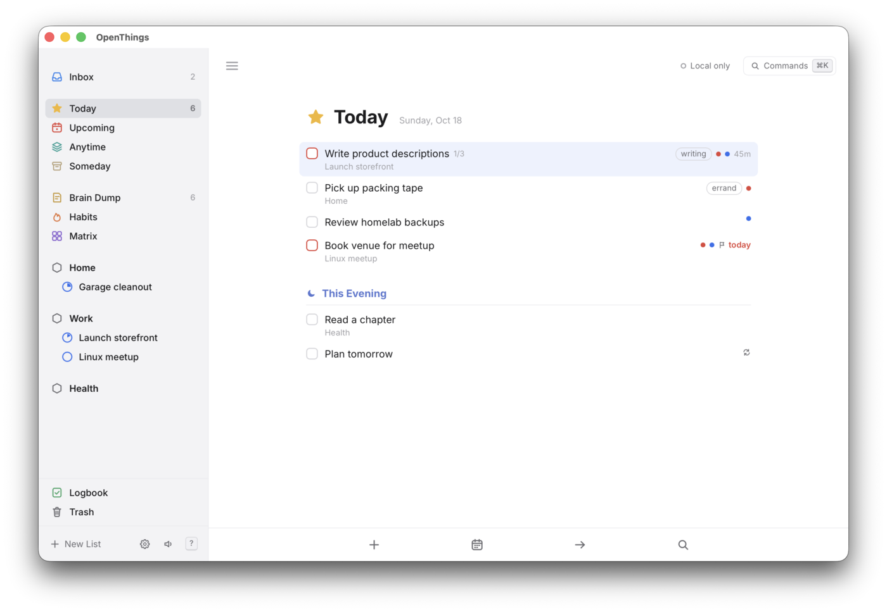
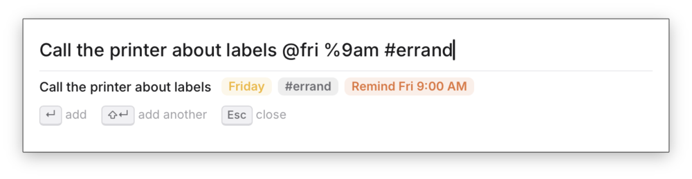
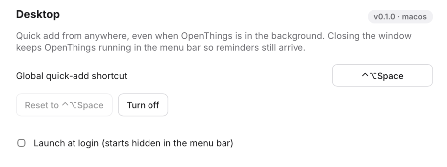
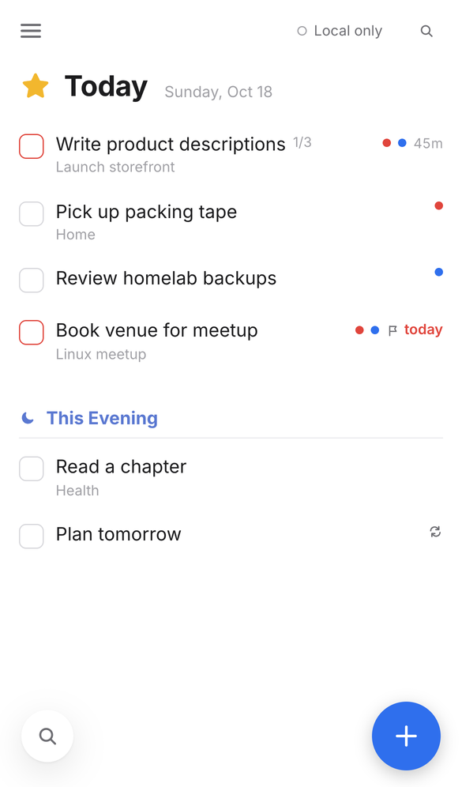
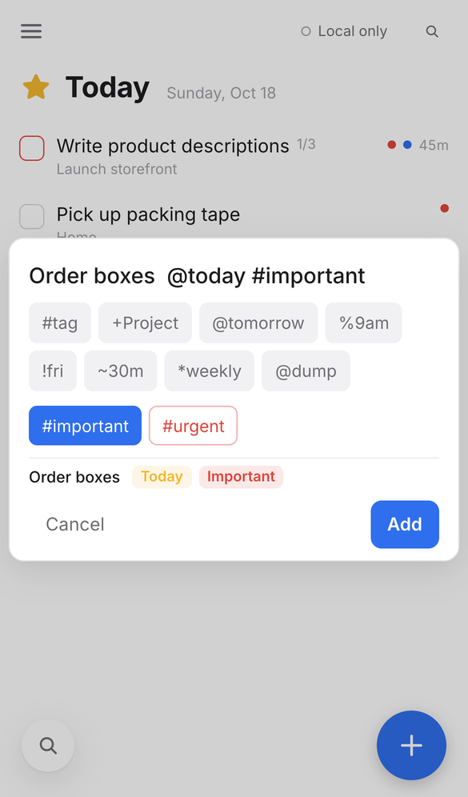
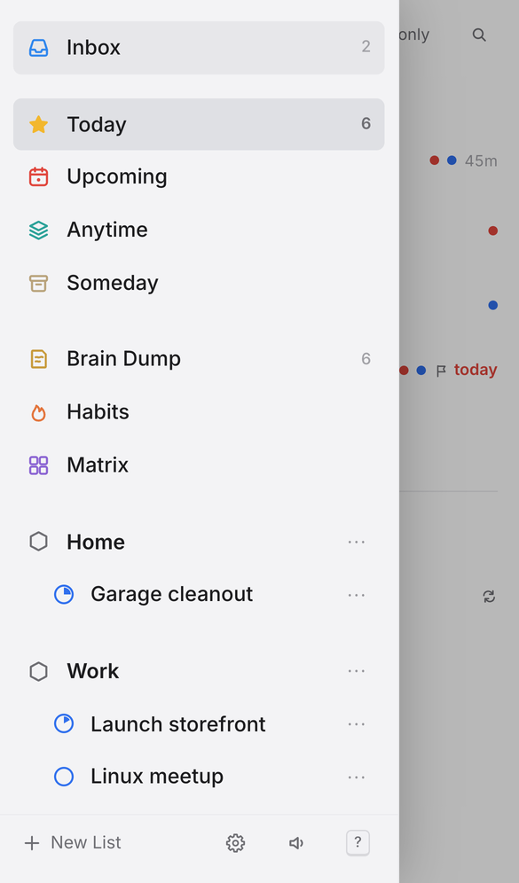
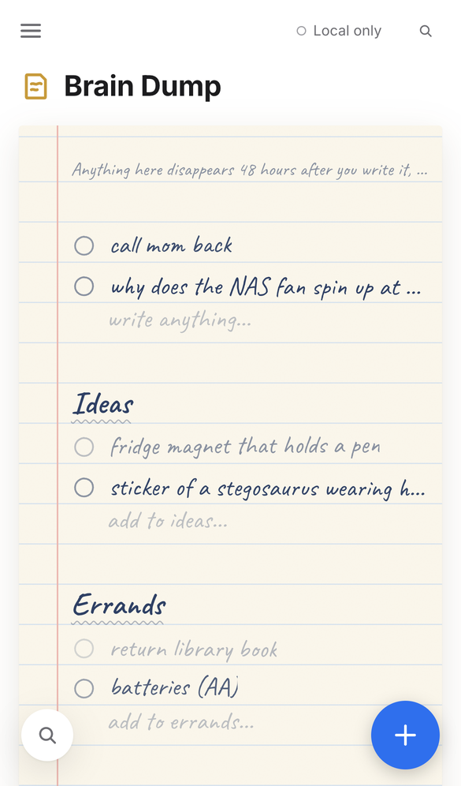

<p align="center">
  
</p>

<h1 align="center">OpenThings</h1>

<p align="center">
  <b>A self-hosted, local-first task manager with a calm, keyboard-first design.</b><br>
  Plan your day with Today, Upcoming and Areas, then focus with a built-in Pomodoro, habits, reminders and an Eisenhower matrix.
  Capture anything in a brain dump that tidies itself after 48 hours. Runs in your browser on desktop and phone, from one Docker container you host, and as an iPhone app and a desktop app for macOS and Arch Linux.
</p>

<p align="center">
  <a href="https://spuder.github.io/OpenThings/app/"></a>
  <a href="https://github.com/spuder/OpenThings/pkgs/container/openthings"></a>
  <a href="#self-hosting"></a>
  <a href="#ios-app"></a>
  <a href="#desktop-app"></a>
</p>

<p align="center">
  <a href="https://spuder.github.io/OpenThings/">Website</a> ·
  <a href="https://spuder.github.io/OpenThings/app/">Try it in the browser</a> ·
  <a href="#self-hosting">Self-hosting</a> ·
  <a href="#features">Features</a> ·
  <a href="#roadmap">Roadmap</a> ·
  <a href="docs/sync.md">Sync protocol</a> ·
  <a href="docs/api.md">REST &amp; MCP</a> ·
  <a href="docs/ios.md">iOS app</a> ·
  <a href="AGENTS.md">Contributing</a> ·
  <a href="https://github.com/spuder/OpenThings/issues">Issues</a>
</p>

<p align="center">
  <a href="https://github.com/spuder/OpenThings/actions/workflows/container.yml"></a>
  <a href="https://github.com/spuder/OpenThings/pkgs/container/openthings"></a>
  <a href="https://github.com/spuder/OpenThings/pkgs/container/openthings"></a>
  <a href="LICENSE"></a>
  <a href="https://github.com/spuder/OpenThings/commits/main"></a>
  <a href="https://github.com/spuder/OpenThings/issues"></a>
  <a href="https://github.com/spuder/OpenThings/stargazers"></a>
</p>

<p align="center">
  
</p>

> **Status: proof of concept.** Works in desktop and phone browsers and installs to the home screen. Data lives on each device (SQLite in IndexedDB) and syncs through the server in the Docker image, which also offers a REST API and an MCP endpoint for AI assistants. An **iOS app** (Capacitor, with widgets, share sheet and Shortcuts) runs on iPhone (tested on an iPhone 15); build it yourself with Xcode, see [iOS app](#ios-app). A [desktop app](#desktop-app) for macOS and Arch Linux is in preview. **Android** is coming and [needs testers](https://github.com/spuder/OpenThings/issues/6).
>
> Inspired by the principles of [Things 3](https://culturedcode.com/things/) and [Super Productivity](https://github.com/super-productivity/super-productivity), built independently and not affiliated with either. See [AGENTS.md](AGENTS.md) for the clean-room and licensing rules.

| Brain Dump | Matrix |
| --- | --- |
|  |  |
| **Habits** | **Quick add** |
|  |  |

## Features

- **Lists:** Inbox, Today with This Evening, Upcoming, Anytime, Someday, Logbook.
- **Structure:** Areas of responsibility → Projects → Headings → To-dos, with notes, checklists, tags, deadlines and repeats.
- **This Week** (optional, off by default): everything scheduled or due from today through Sunday, grouped by day; overdue items fold into today. `G W` to open.
- **Features** in Settings turn optional lists on or off per device: Brain Dump (on by default) and This Week (off).
- **Brain Dump:** a paper-styled scratch list. Unchecked items fade over 48 hours, then are deleted for good. Check them off, or keep them by moving to the Inbox, Today or any list. Supports sections.
- **Habits** with a 21-day grid (7 on phones) and streaks. Optional **challenges** of a fixed length: 30, 60, 75 days or any number, with day count, missed days and end date. Press `C` on a habit, or name it `Cold shower 75d`. **Schedules:** every day, weekdays, specific days, or N times a week on any days (`W` on a habit, or name it `Gym 5x` / `Journal weekdays`); streaks and missed days follow the schedule.
- **Matrix:** Eisenhower quadrants from urgent / important flags.
- **Focus mode:** select a to-do and press `F` for a full-screen Pomodoro (15/25/50 min) with breaks, session count, its checklist and a Complete button. It keeps running if you close it; a pill in the header takes you back.
- **Time tracking** per task.
- **Completion chimes**, synthesized in the browser (toggle with ⇧M).
- **Reminders:** press `A` on a to-do or type `%9am`, `%in30m`, `%fri-9am` in quick add. Due reminders show a system notification, play a chime and appear in the app while OpenThings is open (tab or installed app); missed ones fire on next open. In the [iOS app](#ios-app) they are scheduled with the system and arrive even when the app is closed. Settings shows permission and upcoming reminders.
- **Areas and projects** can be renamed, moved or deleted from the ⋯ button or right-click in the sidebar (or `⇧L`).
- **Appearance:** System, Light or Dark in Settings, or `⇧D` to toggle. On desktop, `⇧T` opens a theme switcher with all 23 [Omarchy](https://omarchy.org) themes (Tokyo Night, Catppuccin, Gruvbox, Nord, Rose Pine…), previewed live as you move through them.
- **Trash:** deleted to-dos can be restored for 30 days, then they're purged.
- **Sync** between your devices through your own server, with status on every screen. Works offline; changes merge per field when you reconnect. See [docs/sync.md](docs/sync.md).
- **REST API** for scripts, Home Assistant, n8n and Shortcuts, and an **MCP endpoint** so AI assistants (Claude and other MCP clients) can read and manage your to-dos. Quick-add syntax works in both. Settings has ready-to-copy config; reference in [docs/api.md](docs/api.md).
- **Import from Things 3** (macOS desktop app): Settings → Data finds your Things database automatically and brings across areas, projects, headings, to-dos, tags and checklists. Repeat rules and reminders are left behind, and nothing is uploaded. The web version explains that importing is desktop-only. See [docs/import.md](docs/import.md).
- **Mobile:** responsive layout, tap to open tasks, tap outside to close, larger touch targets, installable as a home-screen app. Floating **Find** (bottom left) and **add** (bottom right) buttons; **swipe right** for your lists, **pull down** at the top of a list for Quick Find. What you're editing stays above the on-screen keyboard.
- **Quick add** with short syntax (below), from anywhere with `Q`. It starts with the list you're in (`+Project` or `@today`) after the cursor, so you can change it. Once you type, the syntax keys appear as tappable chips, and `#important` / `#urgent` are one tap away. In Brain Dump it's a plain box: no syntax, just write.
- **Quick Find** (`/` or `Ctrl/⌘ F`): recent lists with counts, then search lists, projects, areas, `#tags` and to-dos as you type.
- **Bottom toolbar** on desktop with New to-do, When, Move and Quick Find; hide the sidebar with `Ctrl/⌘ /`.
- **Command palette** (`Ctrl/⌘ K`) and a shortcut sheet (`?`).
- **Local-first data:** SQLite (WASM) with an op log of every change, which is what syncs. JSON export.
- Light and dark mode.

## Quick add syntax

| Token | Meaning |
| --- | --- |
| `#tag` | Tag |
| `+Project` | Project or area (hyphens for spaces: `+Launch-storefront`) |
| `@today` `@tonight` `@tomorrow` `@someday` `@inbox` | When |
| `@fri` `@in3d` `@2w` `@next-week` `@nov-3` `@2026-11-02` | When, by weekday, offset or date |
| `@dump` `@dump/Ideas` | Brain dump, optional section |
| `!fri` | Deadline |
| `%9am` `%18:30` `%in30m` `%fri-9am` | Reminder |
| `~30m` `~1h30m` | Time estimate |
| `*daily` `*weekly` `*weekdays` `*2w` | Repeat |
| `#urgent` `#important` (or `^u` `^i` `^ui`) | Urgent / important (Matrix) |
| `… // notes` | Everything after `//` becomes notes |

Example: `Photograph products +Launch-storefront @fri !next-week ~45m #shop #important`

## Keyboard

| Keys | Action |
| --- | --- |
| `Q` / `N` | Quick add |
| `B` | Add to brain dump |
| `Alt+1…9` or `G` then `I T U A S L D H M` | Inbox, Today, Upcoming, Anytime, Someday, Logbook, Dump, Habits, Matrix |
| `G W` | This Week (when turned on in Settings → Features) |
| `J` / `K` | Move selection |
| `Enter` | Open / close task |
| `X` | Complete |
| `T` `E` `R` `S` | Today, This Evening, Tomorrow, Someday |
| `W` / `D` / `A` | When… / Deadline… / Reminder… |
| `M` | Move to list |
| `#` | Tag |
| `U` / `I` | Urgent / important |
| `F` | Focus mode (Pomodoro on the selected to-do) |
| `P` / `⇧P` | Timer / quick Pomodoro |
| `⇧L` | Rename / move / delete the current area or project |
| `⇧D` | Toggle dark mode |
| `⇧T` | Theme switcher (Omarchy themes, desktop) |
| `Alt+↑` / `Alt+↓` | Reorder |
| `⌫` | Move to Trash |
| `Alt+0` / `G X` | Trash (`⇧R` restore) |
| `C` | Habit challenge length |
| `Ctrl/⌘ ,` | Settings |
| `/` or `Ctrl/⌘ F` | Quick Find |
| `Ctrl/⌘ /` | Show / hide sidebar |
| `Ctrl/⌘ K` | Command palette |
| `?` | All shortcuts |

## Development

```sh
npm install
npm run dev          # http://localhost:5173 (proxies /api and /mcp to the server)
npm run server       # sync, REST and MCP server on http://localhost:8080, needs Bun; serves dist/
npm test             # app tests (Vitest)
npm run test:server  # server tests (Bun)
npm run check
npm run build
```

A fresh install starts empty — there is no demo data.

## Desktop app

<p align="center">
  
</p>

| Quick add from anywhere (⌃⌥Space) | Settings → Desktop |
| --- | --- |
|  |  |

A native shell ([Tauri](https://tauri.app)) around the same app, for **macOS** and **Arch Linux** (Omarchy / Hyprland). It adds a global quick-add hotkey with a floating quick-add window, a menu-bar / tray icon with sync status, reminders as native notifications even with the window closed, a macOS menu bar, launch at login, and `openthings://` links. Details and a test checklist: [docs/desktop.md](docs/desktop.md).

**macOS with [Homebrew](https://brew.sh)** (one universal build for Apple silicon and Intel):

```sh
brew tap spuder/openthings
brew install --cask openthings
```

The cask lives in [spuder/homebrew-openthings](https://github.com/spuder/homebrew-openthings) and also puts the `openthings` CLI on your PATH. Update with `brew upgrade --cask openthings`.

**Download:** tagged versions are on the [Releases](https://github.com/spuder/OpenThings/releases) page. For a build of the latest commit, open the latest green [Desktop workflow run](https://github.com/spuder/OpenThings/actions/workflows/desktop.yml) and download the artifact (sign in to GitHub): `OpenThings-macos-universal` (`.dmg`, Apple silicon and Intel) or `OpenThings-arch-x86_64` (AppImage and the tarball for `packaging/arch/openthings-bin`).

**Nix** (Linux and macOS, Intel and ARM): `nix run github:spuder/OpenThings`, or `nix profile install github:spuder/OpenThings`. See [docs/nix.md](docs/nix.md).

**macOS first launch:** the build isn't notarized yet, so macOS blocks it the first time. Open it once, then System Settings → Privacy & Security → **Open Anyway** (on older macOS: right-click the app → Open).

**Quick add from anywhere:** ⌃⌥Space on macOS (Ctrl+Alt+Space on X11), changeable in Settings → Desktop. On Wayland apps can't grab global keys, so bind the CLI in Hyprland (Super+Space is Omarchy's launcher):

```ini
# ~/.config/hypr/bindings.conf
bind = SUPER ALT, SPACE, exec, openthings --quick-add
windowrule {
  name = openthings-quick-add
  match:title = ^(OpenThings Quick Add)$
  float = on
  center = on
  pin = on
}
```

`openthings --add "Buy milk #errand"` adds without a window; `openthings://add?text=…` links work too. The tray icon needs a tray host such as Waybar's `tray` module; notifications go to mako / dunst / swaync. Data stays local to the desktop app (separate from your browser's copy). AUR-ready PKGBUILDs are in `packaging/arch/`.

## iOS app

| Today | Quick add | Lists | Brain Dump |
| --- | --- | --- | --- |
|  |  |  |  |

The iPhone/iPad app is this same web app in a [Capacitor](https://capacitorjs.com) shell, plus native pieces: reminders scheduled as iOS notifications (they arrive with the app closed), Home and Lock Screen widgets (Today, sync status), a Share Sheet extension (to Inbox or Brain Dump), and Shortcuts/Siri actions (**Add To-Do** with quick-add syntax, **Open Today**). Data stays on the device, and syncs with your server if you turn sync on in Settings. Architecture and a device test checklist: [docs/ios.md](docs/ios.md). It isn't on the App Store yet, so for now you build it yourself.

**Android** is planned from the same Capacitor setup. If you'd like to test it, comment on [issue #6](https://github.com/spuder/OpenThings/issues/6).

To run it on your iPhone you need a Mac with Xcode 26+ (widgets, share sheet and Shortcuts also need a paid Apple Developer account for the App Group):

```sh
npm ci && npm run build && npx cap sync ios
echo 'DEVELOPMENT_TEAM = ABCDE12345' > ios/App/Config/OpenThings.local.xcconfig   # your team id
npx cap open ios
```

In Xcode, check *Signing & Capabilities* on the **App**, **OpenThingsWidgets** and **OpenThingsShare** targets (team set, App Group `group.io.github.spuder.openthings` registered), pick your iPhone and press Run. Bundle id, App Group and URL scheme live in one file, `ios/App/Config/OpenThings.xcconfig` (override them in `OpenThings.local.xcconfig`, which is not committed). After web changes: `npm run build && npx cap sync ios`.

## Self-hosting

Images are published to GHCR by GitHub Actions on every push to `main` (`latest`, `sha-<short>`) and on `v*` tags (`1.2.3`, `1.2`), for `linux/amd64` and `linux/arm64`.

```sh
curl -O https://raw.githubusercontent.com/spuder/OpenThings/main/compose.yaml
docker compose up -d
```

`compose.yaml` pulls `ghcr.io/spuder/openthings:latest` and carries [DockTail](https://github.com/marvinvr/docktail) labels, so with DockTail running on the host the app appears at `https://openthings.<tailnet>.ts.net` with no published ports. Without DockTail, add `ports: ["8080:8080"]`. To build locally: `docker build -t openthings .`

The container is one [Bun](https://bun.sh) process that serves:

| Path | What |
| --- | --- |
| `/` | The web app |
| `/api/health`, `/api/sync` | Sync between devices ([docs/sync.md](docs/sync.md)) |
| `/api/v1/…` | REST API ([docs/api.md](docs/api.md)) |
| `/mcp` | MCP endpoint (Streamable HTTP) for AI assistants ([docs/api.md](docs/api.md#mcp)) |

To sync a device, open **Settings → Sync**, press **Use this site** (or enter the server URL in the iOS app) and **Turn on sync**. Each device still keeps a full copy and works offline.

To connect Claude Code:

```sh
claude mcp add --transport http openthings https://openthings.<tailnet>.ts.net/mcp
```

| Setting | Default | |
| --- | --- | --- |
| Volume `/data` | | The server's SQLite database (`openthings.sqlite`). Back it up; it holds every device's changes. |
| `TZ` | `UTC` | Time zone for "today" in the REST API and MCP tools, e.g. `America/Denver`. |
| `OPENTHINGS_ALLOWED_ORIGINS` | | Extra web origins allowed to call the API from a browser, comma-separated. The server's own origin and the iOS app always are. |
| `PORT` | `8080` | |

There's no login: anyone who can reach the server can read and change your to-dos, so keep it on your tailnet (as DockTail does) or another private network. Browsers on other websites are refused, so a page you visit can't reach it through your browser. Device tokens are planned before anything is exposed more widely.

**Without Docker:** `nix run github:spuder/OpenThings#openthings-server`, or on NixOS `services.openthings.enable = true;` from the flake's module ([docs/nix.md](docs/nix.md)).

Run the server locally with `npm run build && npm run server` (http://localhost:8080); `npm run dev` proxies `/api` and `/mcp` to it.

## Roadmap

1. **Server:** sync, the REST API and MCP ship in the Docker image ([Self-hosting](#self-hosting)). Next: device tokens, and reminders sent from the server (Web Push) so they arrive with the app closed.
2. **Calendar time-blocking:** drag tasks onto a day timeline; blocks sync to a CalDAV calendar (iCloud, Radicale, Nextcloud, etc.) from the server, and existing events show as busy time.
3. **Desktop:** Tauri shell with a global quick-add hotkey (macOS and Omarchy/Hyprland) in preview, installable on macOS with Homebrew and on Linux and macOS with Nix, see [Desktop app](#desktop-app). Next: signing and notarization, AUR, nixpkgs, Ubuntu/Fedora packages.
4. **Mobile:** iOS app with widgets, Shortcuts and share sheet: runs on iPhone ([docs/ios.md](docs/ios.md)). Next: interactive widgets, then Android from the same Capacitor setup ([testers wanted](https://github.com/spuder/OpenThings/issues/6)).
5. More importers: a CLI, and Super Productivity backups (evaluated in [docs/import.md](docs/import.md)).

## License

[MIT](LICENSE). Third-party licenses: [THIRD_PARTY_NOTICES.md](THIRD_PARTY_NOTICES.md).
