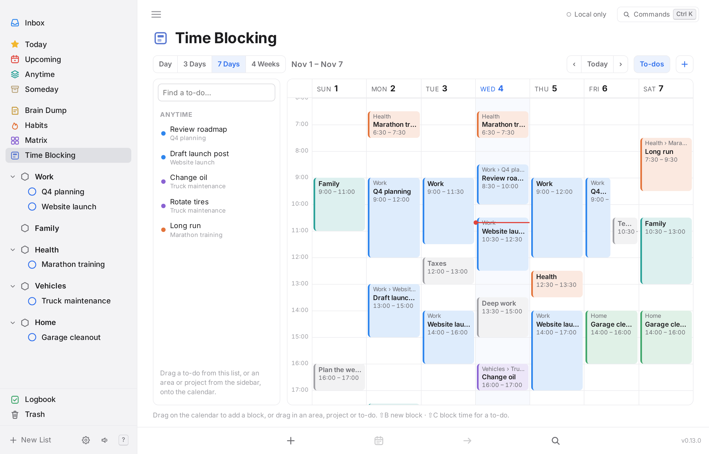
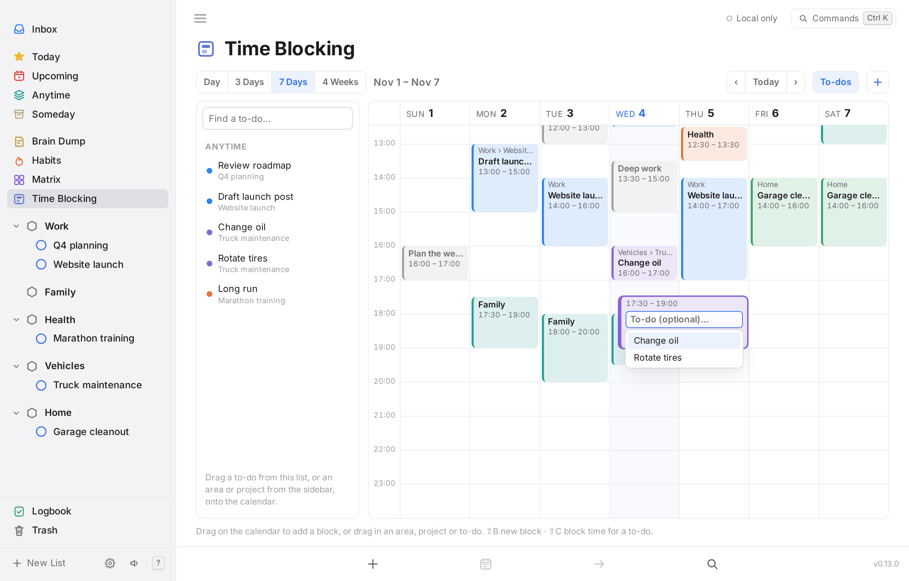
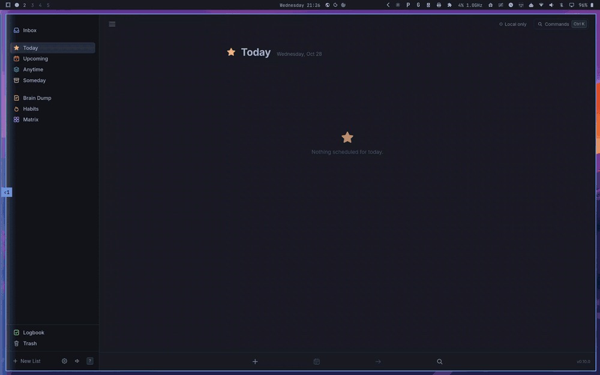
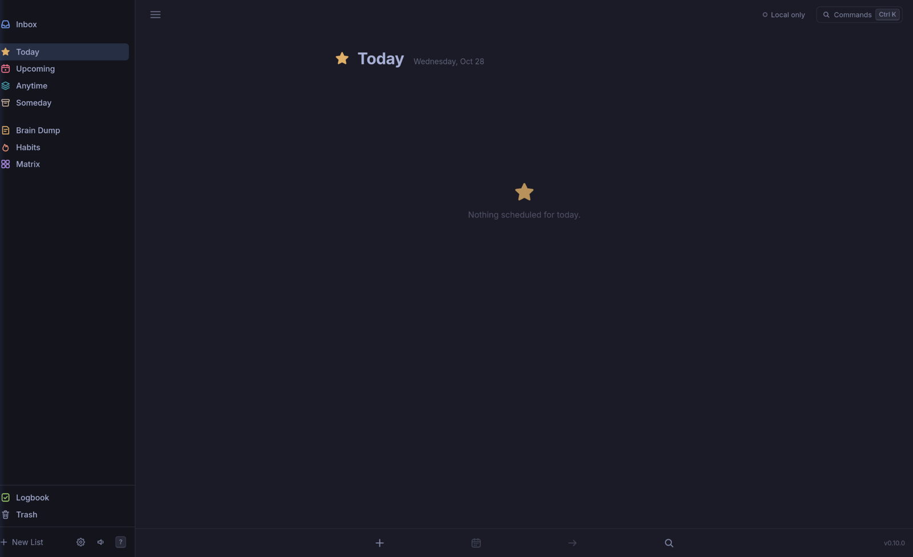
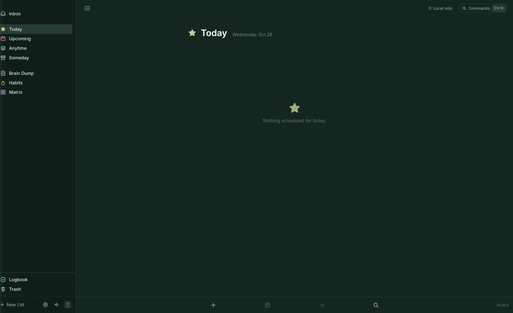
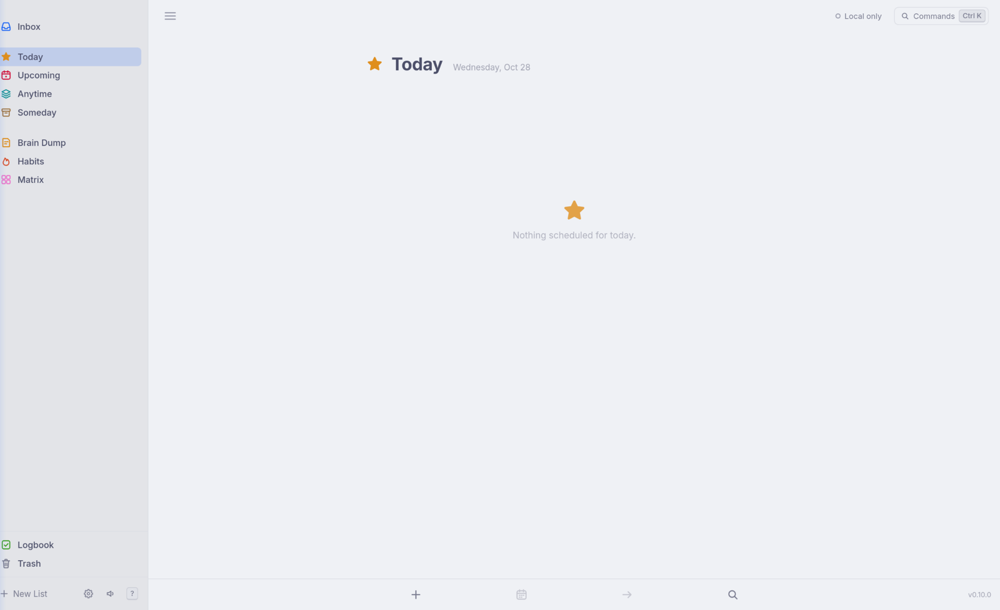

<p align="center">
  
</p>

<h1 align="center">OpenThings</h1>

<p align="center">
  <b>A self-hosted, local-first task manager with a calm, keyboard-first design.</b><br>
  Plan your day with Today, Upcoming and Areas, then focus with a built-in Pomodoro, habits, reminders and an Eisenhower matrix.
  Capture anything in a brain dump that tidies itself after 48 hours. Runs in your browser on desktop and phone, from one Docker container you host, and as an iPhone app and a desktop app for macOS and Arch Linux.
</p>

<p align="center">
  <a href="https://spuder.github.io/OpenThings/app/"></a>
  <a href="https://github.com/spuder/OpenThings/pkgs/container/openthings"></a>
  <a href="#self-hosting"></a>
  <a href="#ios-app"></a>
  <a href="#desktop-app"></a>
</p>

<p align="center">
  <a href="https://spuder.github.io/OpenThings/">Website</a> ·
  <a href="https://spuder.github.io/OpenThings/app/">Try it in the browser</a> ·
  <a href="#self-hosting">Self-hosting</a> ·
  <a href="#features">Features</a> ·
  <a href="#roadmap">Roadmap</a> ·
  <a href="docs/sync.md">Sync protocol</a> ·
  <a href="docs/api.md">REST &amp; MCP</a> ·
  <a href="docs/ios.md">iOS app</a> ·
  <a href="AGENTS.md">Contributing</a> ·
  <a href="https://github.com/spuder/OpenThings/issues">Issues</a>
</p>

<p align="center">
  <a href="https://github.com/spuder/OpenThings/actions/workflows/container.yml"></a>
  <a href="https://github.com/spuder/OpenThings/pkgs/container/openthings"></a>
  <a href="https://github.com/spuder/OpenThings/pkgs/container/openthings"></a>
  <a href="LICENSE"></a>
  <a href="https://github.com/spuder/OpenThings/commits/main"></a>
  <a href="https://github.com/spuder/OpenThings/issues"></a>
  <a href="https://github.com/spuder/OpenThings/stargazers"></a>
</p>

<p align="center">
  
</p>

> **Status: proof of concept.** Works in desktop and phone browsers and installs to the home screen. Data lives on each device (SQLite in IndexedDB) and syncs through the server in the Docker image, which also offers a REST API and an MCP endpoint for AI assistants. An **iOS app** (Capacitor, with widgets, share sheet and Shortcuts) runs on iPhone (tested on an iPhone 15); build it yourself with Xcode, see [iOS app](#ios-app). A [desktop app](#desktop-app) for macOS and Arch Linux is in preview. An **Android app** from the same code is in preview and [needs testers](https://github.com/spuder/OpenThings/issues/6), see [Android app](#android-app).
>
> Inspired by the principles of [Things 3](https://culturedcode.com/things/) and [Super Productivity](https://github.com/super-productivity/super-productivity), built independently and not affiliated with either. See [AGENTS.md](AGENTS.md) for the clean-room and licensing rules.

| Brain Dump | Matrix |
| --- | --- |
|  |  |
| **Habits** | **Quick add** |
|  |  |
| **Time Blocking** | **Assigning a block** |
|  |  |

## Features

- **Lists:** Inbox, Today with This Evening, Upcoming, Anytime, Someday, Logbook.
- **Structure:** Areas of responsibility → Projects → Headings → To-dos, with notes, checklists, tags, deadlines and repeats.
- **Repeating to-dos:** every N days, weeks, months or years; chosen days of the week; days of the month (the 1st and 15th, the last day) or an ordinal weekday (the 2nd Tuesday, the last Friday); ending never, after N times or on a date. Set it in quick add (`*mon,thu`) or in the repeat editor (`⇧W`, the repeat button on an open to-do, or right-click), which previews the next dates. Checking one off schedules the next.
- **This Week** (optional, off by default): everything scheduled or due from today through Sunday, grouped by day; overdue items fold into today. `G W` to open.
- **Time Blocking** (on by default, can be turned off; prototype): a calendar of blocks of time, in Day, 3 days, 7 days or 4 weeks (weeks start on Sunday). Drag on empty space to add a block, drag it to move it, drag its top or bottom edge to resize (long-press first on touch). A new block's inline box autocompletes an area (`VEH` → Vehicles), then optionally a project and a to-do in it, each accepted with `Enter`; `Esc` stops at any level. Type a name that isn't an area for a plain block, like "Taxes". Or drag an area or project from the sidebar, or a to-do from the calendar's To-dos panel (Today and Upcoming, or search), onto the calendar: the block is linked to it and sized by the to-do's estimate (an hour otherwise). `⇧C` does the same from the keyboard for the selected to-do or the area or project you're in. Drop a to-do on a block of its area or project and it goes **inside** that block instead (a block can hold several, each with a checkbox); dragging a single-to-do block onto such a block merges them. Drag a to-do out of a block onto the calendar or back onto To-dos, or press × on a selected block. Blocks take their area's color and sync like everything else. Areas get a color automatically; pick your own with `⇧L` → Color… in the area. `G C` to open, `⇧B` for a new block.
- **Calendar subscription:** the server publishes your time blocks read only, so they show in Apple Calendar, Google Calendar, Outlook, Thunderbird or DAVx5. Add `https://<server>/dav/` as a CalDAV account for one calendar per area ("OpenThings · Work"…, plus "Other") in each area's color, or subscribe to `webcal://<server>/cal/openthings.ics` for everything in one calendar named **OpenThings**, or to one area's feed. Settings → Calendar subscription has the addresses. See [Calendar subscription](docs/api.md#calendar-subscription).
- **Features** in Settings turn optional lists on or off per device: Brain Dump and Time Blocking (on by default) and This Week (off).
- **Brain Dump:** a paper-styled scratch list. Unchecked items fade over 48 hours, then are deleted for good. Check them off, or keep them by moving to the Inbox, Today or any list. Supports sections.
- **Habits** with a 21-day grid (7 on phones) and streaks. Optional **challenges** of a fixed length: 30, 60, 75 days or any number, with day count, missed days and end date. Press `C` on a habit, or name it `Cold shower 75d`. **Schedules:** every day, weekdays, specific days, or N times a week on any days (`W` on a habit, or name it `Gym 5x` / `Journal weekdays`); streaks and missed days follow the schedule.
- **Matrix:** Eisenhower quadrants from urgent / important flags.
- **Focus mode:** select a to-do and press `F` for a full-screen Pomodoro (15/25/50 min) with breaks, session count, its checklist and a Complete button. It keeps running if you close it; a pill in the header takes you back.
- **Time tracking** per task.
- **Completion chimes** and a paper crumple on Move to Trash and Empty Trash, synthesized in the browser (toggle with ⇧M).
- **Reminders:** press `A` on a to-do or type `%9am`, `%in30m`, `%fri-9am` in quick add. Due reminders show a system notification, play a chime and appear in the app while OpenThings is open (tab or installed app); missed ones fire on next open. In the [iOS app](#ios-app) they are scheduled with the system and arrive even when the app is closed. Settings shows permission and upcoming reminders.
- **Areas and projects** can be renamed, moved or deleted from the ⋯ button or right-click in the sidebar (or `⇧L`).
- **Collapse areas** in the sidebar with the chevron beside each one; ⌥/Alt-click it, or pick *Collapse all areas* from an area's ⋯ menu, to fold them all.
- **Appearance:** System, Light or Dark in Settings, or `⇧D` to toggle. On desktop, `⇧T` opens a theme switcher with all 23 [Omarchy](https://omarchy.org) themes (Tokyo Night, Catppuccin, Gruvbox, Nord, Rose Pine…), previewed live as you move through them. On an Omarchy desktop the app follows the desktop's theme instead, and changes with it.
- **Trash:** deleted to-dos can be restored for 30 days, then they're purged.
- **Sync** between your devices through your own server, with status on every screen. Works offline; changes merge per field when you reconnect. See [docs/sync.md](docs/sync.md).
- **REST API** for scripts, Home Assistant, n8n and Shortcuts, and an **MCP endpoint** so AI assistants (Claude and other MCP clients) can read and manage your to-dos. Quick-add syntax works in both. Settings has ready-to-copy config; reference in [docs/api.md](docs/api.md).
- **Import from Things 3** (macOS desktop app): Settings → Data finds your Things database automatically and brings across areas, projects, headings, to-dos, tags and checklists. Repeat rules and reminders are left behind, and nothing is uploaded. The web version explains that importing is desktop-only. See [docs/import.md](docs/import.md).
- **Mobile:** responsive layout, tap to open tasks, tap outside to close, larger touch targets, installable as a home-screen app. Floating **Find** (bottom left) and **add** (bottom right) buttons; **swipe a to-do right** for Complete or Move, **left** for Move to Trash, **swipe right** elsewhere for your lists, **pull down** at the top of a list for Quick Find. What you're editing stays above the on-screen keyboard.
- **Quick add** with short syntax (below), from anywhere with `N`. It starts with the list you're in (`+Project` or `@today`) after the cursor, so you can change it. Once you type, the syntax keys appear as tappable chips, and `#important` / `#urgent` are one tap away. In Brain Dump it's a plain box: no syntax, just write.
- **Quick Find** (`/` or `Ctrl/⌘ F`): recent lists with counts, then search lists, projects, areas, `#tags` and to-dos as you type.
- **Bottom toolbar** on desktop with New to-do, When, Move and Quick Find; hide the sidebar with `Ctrl/⌘ /`.
- **Command palette** (`Ctrl/⌘ K`) and a shortcut sheet (`?`).
- **Local-first data:** SQLite (WASM) with an op log of every change, which is what syncs. JSON export.
- Light and dark mode.

## Quick add syntax

| Token | Meaning |
| --- | --- |
| `#tag` | Tag |
| `+Project` | Project or area (hyphens for spaces: `+Launch-storefront`) |
| `@today` `@tonight` `@tomorrow` `@someday` `@inbox` | When |
| `@fri` `@in3d` `@2w` `@next-week` `@nov-3` `@2026-11-02` | When, by weekday, offset or date |
| `@dump` `@dump/Ideas` | Brain dump, optional section |
| `!fri` | Deadline |
| `%9am` `%18:30` `%in30m` `%fri-9am` | Reminder |
| `~30m` `~1h30m` | Time estimate |
| `*daily` `*weekly` `*monthly` `*yearly` `*weekdays` `*weekends` | Repeat |
| `*2d` `*3w` `*2m` `*1y` | Repeat every N days, weeks, months, years |
| `*mon,thu` `*fri` `*2w-mon,thu` | Repeat weekly on those days (every 2 weeks) |
| `*1st,15th` `*15th` `*last-day` `*1st,last` | Repeat monthly on those days of the month |
| `*2nd-tue` `*last-fri` `*first-mon` `*last-weekday` | Repeat monthly on an ordinal weekday |
| `#urgent` `#important` (or `^u` `^i` `^ui`) | Urgent / important (Matrix) |
| `… // notes` | Everything after `//` becomes notes |

Example: `Photograph products +Launch-storefront @fri !next-week ~45m #shop #important`

## Keyboard

| Keys | Action |
| --- | --- |
| `N` | Quick add |
| `B` | Add to brain dump |
| `Ctrl/⌘ ⇧N` | New project |
| `⇧H` | New heading (project), section (Brain Dump) or habit (Habits) |
| `⇧⌫` | Remove a Brain Dump section |
| `Alt+1…9` or `G` then `I T U A S L D H M` | Inbox, Today, Upcoming, Anytime, Someday, Logbook, Dump, Habits, Matrix |
| `G W` | This Week (when turned on in Settings → Features) |
| `G C` | Time Blocking (turn it off in Settings → Features). In it: `⇧B` new block, `J` / `K` select, `↵` assign, `⇧J` / `⇧K` move 15 min, `⌥⇧↓` / `⌥⇧↑` longer / shorter, `⇧H` / `⇧L` another day, `[` / `]` previous / next, `T` today, `1` `3` `7` `4` range, `L` show / hide To-dos, `⌫` delete |
| `⇧C` | Block time on the calendar for the selected to-do, or the area or project you're in |
| `J` / `K` | Move selection |
| `Enter` | Open / close task |
| `C` | Complete |
| `T` `E` `R` `S` | Today, This Evening, Tomorrow, Someday |
| `W` / `D` / `A` | When… / Deadline… / Reminder… |
| `⇧W` | Repeat… (also on right-click and in an open to-do) |
| `M` | Move to list |
| `#` | Tag |
| `U` / `I` | Urgent / important |
| `F` | Focus mode (Pomodoro on the selected to-do) |
| `P` / `⇧P` | Timer / quick Pomodoro |
| `⇧L` | Rename / move / delete the current area or project, or remove one of its headings. In that menu, each option's underlined letter runs it (`R` rename, `M` move, `H` new heading, `E` remove heading, `C` complete, `D` delete) |
| `⇧D` | Toggle dark mode |
| `⇧T` | Theme switcher (Omarchy themes, desktop) |
| `Alt+↑` / `Alt+↓` | Reorder |
| `⌫` | Move to Trash |
| `Alt+0` / `G X` | Trash (`⇧R` restore) |
| `C` | Habit challenge length |
| `Ctrl/⌘ ,` | Settings |
| `/` or `Ctrl/⌘ F` | Quick Find |
| `Ctrl/⌘ /` | Show / hide sidebar |
| `z a` | Collapse / expand the current area in the sidebar |
| `z m` / `z r` | Collapse / expand all areas |
| `Ctrl/⌘ K` | Command palette |
| `?` | All shortcuts |

## Development

```sh
npm install
npm run dev          # http://localhost:5173 (proxies /api and /mcp to the server)
npm run server       # sync, REST and MCP server on http://localhost:8080, needs Bun; serves dist/
npm test             # app tests (Vitest)
npm run test:server  # server tests (Bun)
npm run check
npm run build
```

A fresh install starts empty — there is no demo data.

## Desktop app

<p align="center">
  
</p>

| Quick add from anywhere (⌃Space) | Settings → Desktop |
| --- | --- |
|  |  |

A native shell ([Tauri](https://tauri.app)) around the same app, for **macOS** and **Arch Linux** (Omarchy / Hyprland). It adds a global quick-add hotkey with a floating quick-add window, a menu-bar / tray icon with sync status, reminders as native notifications even with the window closed, a macOS menu bar, launch at login, and `openthings://` links. Details and a test checklist: [docs/desktop.md](docs/desktop.md).

The desktop app works on its own; to sync it with your phone or other computers, run the server from [Self-hosting](#self-hosting) and enter its URL in **Settings → Sync**.

**macOS with [Homebrew](https://brew.sh)** (one universal build for Apple silicon and Intel):

```sh
brew tap spuder/openthings
brew trust spuder/openthings
brew install --cask openthings
```

Recent Homebrew versions refuse to load casks from untrusted taps, so the `brew trust` step must come before `brew install`. Without it the install fails with `Refusing to load cask ... from untrusted tap` and nothing is installed.

The cask lives in [spuder/homebrew-openthings](https://github.com/spuder/homebrew-openthings) and also puts the `openthings` CLI on your PATH. Update with `brew upgrade --cask openthings`.

**Arch / Omarchy:** add the OpenThings pacman repo to `/etc/pacman.conf`, then `sudo pacman -Sy openthings-bin` (updates come with `pacman -Syu`). An AUR package is [on the way](https://github.com/spuder/OpenThings/issues/8).

```ini
[openthings]
SigLevel = Optional TrustAll
Server = https://github.com/spuder/OpenThings/releases/download/arch-repo
```

**Download:** tagged versions are on the [Releases](https://github.com/spuder/OpenThings/releases) page. For a build of the latest commit, open the latest green [Desktop workflow run](https://github.com/spuder/OpenThings/actions/workflows/desktop.yml) and download the artifact (sign in to GitHub): `OpenThings-macos-universal` (`.dmg`, Apple silicon and Intel) or `OpenThings-arch-x86_64` (AppImage and the tarball for `packaging/arch/openthings-bin`).

**macOS first launch:** releases are signed and notarized. Builds from pull requests aren't, so macOS blocks them the first time: open it once, then System Settings → Privacy & Security → **Open Anyway** (on older macOS: right-click the app → Open).

**Quick add from anywhere:** ⌃Space on macOS (Ctrl+Alt+Space on X11), changeable in Settings → Desktop. On Hyprland (Omarchy) apps can't grab global keys, so Settings → Desktop writes the bind into Hyprland's config for you: Super+Alt+Space by default, since Super+Space is Omarchy's launcher. On other Wayland compositors, bind `openthings --quick-add` yourself ([docs/desktop.md](docs/desktop.md#hyprland-omarchy)).

**Follows your Omarchy theme:** on an Omarchy desktop the app takes its colors from the current theme and changes with it within a second, light or dark, including themes you installed yourself. Pick a theme with Omarchy's theme menu (Super+Ctrl+Shift+Space); the in-app theme choices are hidden while it follows.

<p align="center">
  
</p>

| Tokyo Night | Jade Horse | Catppuccin Latte |
| --- | --- | --- |
|  |  |  |

`openthings --add "Buy milk #errand"` adds without a window; `openthings://add?title=…` links work too, from Automator, Shortcuts or scripts ([docs/url-scheme.md](docs/url-scheme.md)). The tray icon needs a tray host such as Waybar's `tray` module; notifications go to mako / dunst / swaync. Data stays local to the desktop app (separate from your browser's copy). AUR-ready PKGBUILDs are in `packaging/arch/`.

## iOS app

| Today | Quick add | Lists | Brain Dump |
| --- | --- | --- | --- |
|  |  |  |  |

The iPhone/iPad app is this same web app in a [Capacitor](https://capacitorjs.com) shell, plus native pieces: reminders scheduled as iOS notifications (they arrive with the app closed), Home and Lock Screen widgets (Today, sync status), a Share Sheet extension (to Inbox or Brain Dump), and Shortcuts/Siri actions (**Add To-Do** with quick-add syntax, **Open Today**). Data stays on the device, and syncs with your server if you turn sync on in Settings. Architecture and a device test checklist: [docs/ios.md](docs/ios.md). It isn't on the App Store yet, so for now you build it yourself.

**Siri:** say "Add to OpenThings" and Siri asks what to add, or "Show my day in OpenThings" to open Today. Both actions are also in the Shortcuts app for your own shortcuts. Details: [Siri and Shortcuts](docs/ios.md#siri-and-shortcuts).

To run it on your iPhone you need a Mac with Xcode 26+ (widgets, share sheet and Shortcuts also need a paid Apple Developer account for the App Group):

```sh
npm ci && npm run build && npx cap sync ios
echo 'DEVELOPMENT_TEAM = ABCDE12345' > ios/App/Config/OpenThings.local.xcconfig   # your team id
npx cap open ios
```

In Xcode, check *Signing & Capabilities* on the **App**, **OpenThingsWidgets** and **OpenThingsShare** targets (team set, App Group `group.io.github.spuder.openthings` registered), pick your iPhone and press Run. Bundle id, App Group and URL scheme live in one file, `ios/App/Config/OpenThings.xcconfig` (override them in `OpenThings.local.xcconfig`, which is not committed). After web changes: `npm run build && npx cap sync ios`.

## Android app

The same app for Android 7.0 and newer, from the same Capacitor setup: reminders as Android notifications (they arrive with the app closed), Today and Sync status widgets, share to OpenThings from any app, app shortcuts (press and hold the icon), `openthings://` links, the back gesture, and pairing with your server by scanning the QR code. Install the latest build from the [Android preview](https://github.com/spuder/OpenThings/releases/tag/android-preview) release; later builds install over it and keep your to-dos. It's tested in the Android emulator so far; if you'd like to try it on your phone, [sign up as a tester](https://docs.google.com/forms/d/e/1FAIpQLSf0Vke8v5YCE53KemDdbn5VFub2v2MIK32OaTM-B6Sf1psgVg/viewform). Details and how to build it: [docs/android.md](docs/android.md).

## Self-hosting

Images are published to GHCR by GitHub Actions on every push to `main` (`latest`, `sha-<short>`) and on `v*` tags (`1.2.3`, `1.2`), for `linux/amd64` and `linux/arm64`.

```yaml
# compose.yaml
services:
  openthings:
    image: ghcr.io/spuder/openthings:latest
    pull_policy: always
    restart: unless-stopped
    environment:
      TZ: UTC # your time zone, e.g. America/Denver
      # OPENTHINGS_PUBLIC_URL: https://openthings.example.ts.net
    volumes:
      - openthings-data:/data
    labels:
      - "docktail.service.enable=true"
      - "docktail.service.name=openthings"
      - "docktail.service.port=8080"
      - "docktail.service.service-port=443"

volumes:
  openthings-data:
```

```sh
docker compose up -d
```

`compose.yaml` pulls `ghcr.io/spuder/openthings:latest` and carries [DockTail](https://github.com/marvinvr/docktail) labels, so with DockTail running on the host the app appears at `https://openthings.<tailnet>.ts.net` with no published ports. Without DockTail, add `ports: ["8080:8080"]`. To build locally: `docker build -t openthings .`

Set `OPENTHINGS_PUBLIC_URL` to the address your devices use (with DockTail, `https://openthings.<tailnet>.ts.net`; otherwise e.g. `http://192.168.1.10:8080`). The server reports it at `/api/health`, and the apps use it: the web app prefills it in Settings → Sync, and the phone pairing QR code carries it even when the computer showing the code reaches the server another way (say, `localhost`). The container can't find its tailnet name by itself, so this is the one setting to add. Leave it unset and everything else still works.

The container is one [Bun](https://bun.sh) process that serves:

| Path | What |
| --- | --- |
| `/` | The web app |
| `/api/health`, `/api/sync` | Sync between devices ([docs/sync.md](docs/sync.md)) |
| `/api/v1/…` | REST API ([docs/api.md](docs/api.md)) |
| `/mcp` | MCP endpoint (Streamable HTTP) for AI assistants ([docs/api.md](docs/api.md#mcp)) |
| `/cal/…`, `/dav/` | Time blocks as subscribable iCalendar feeds and read-only CalDAV calendars, one per area ([docs/api.md](docs/api.md#calendar-subscription)) |

To sync a device, open **Settings → Sync**, press **Use this site** (or enter the server URL in the desktop and iOS apps) and **Turn on sync**. With `OPENTHINGS_PUBLIC_URL` set, the web app fills the URL in for you. To add a phone without typing the URL, press **Show QR code** there on a computer that syncs with the server, then **Scan QR code** in the iOS app's Settings → Sync. Each device still keeps a full copy and works offline.

To connect Claude Code:

```sh
claude mcp add --transport http openthings https://openthings.<tailnet>.ts.net/mcp
```

| Setting | Default | |
| --- | --- | --- |
| Volume `/data` | | The server's SQLite database (`openthings.sqlite`). Back it up; it holds every device's changes. |
| `TZ` | `UTC` | Time zone for "today" in the REST API and MCP tools, e.g. `America/Denver`. Subscribed calendars are told time blocks are in this zone. |
| `OPENTHINGS_CALENDAR_NAME` | `OpenThings` | Name of the combined time-blocking calendar, and the start of each area's ("OpenThings · Work"). |
| `OPENTHINGS_PUBLIC_URL` | | The address your devices use, e.g. `https://openthings.<tailnet>.ts.net`. Reported by `/api/health`; the web app prefills it in Settings → Sync and the phone pairing QR code carries it. |
| `OPENTHINGS_ALLOWED_ORIGINS` | | Extra web origins allowed to call the API from a browser, comma-separated. The server's own origin and the iOS app always are. |
| `PORT` | `8080` | |

There's no login: anyone who can reach the server can read and change your to-dos, so keep it on your tailnet (as DockTail does) or another private network. Browsers on other websites are refused, so a page you visit can't reach it through your browser. Device tokens are planned before anything is exposed more widely.

Run the server locally with `npm run build && npm run server` (http://localhost:8080); `npm run dev` proxies `/api`, `/mcp`, `/cal` and `/dav` to it.

## Roadmap

1. **Server:** sync, the REST API and MCP ship in the Docker image ([Self-hosting](#self-hosting)). Next: device tokens, and reminders sent from the server (Web Push) so they arrive with the app closed.
2. **Calendar time-blocking:** blocks of time on a calendar, published by the server as an iCalendar feed and a read-only CalDAV calendar (prototype, [#99](https://github.com/spuder/OpenThings/issues/99)). Next: drag to-dos into blocks, a This Week column, and showing other calendars' events as busy time.
3. **Desktop:** Tauri shell with a global quick-add hotkey (macOS and Omarchy/Hyprland) in preview, installable on macOS with Homebrew, see [Desktop app](#desktop-app). Releases are signed and notarized. Next: AUR, Ubuntu/Fedora packages.
4. **Mobile:** iOS app with widgets, Shortcuts and share sheet: runs on iPhone ([docs/ios.md](docs/ios.md)). Android app with widgets, share and app shortcuts in preview ([docs/android.md](docs/android.md), [testers wanted](https://github.com/spuder/OpenThings/issues/6)). Next: interactive widgets on both.
5. More importers: a CLI, and Super Productivity backups (evaluated in [docs/import.md](docs/import.md)).

## License

[MIT](LICENSE). Third-party licenses: [THIRD_PARTY_NOTICES.md](THIRD_PARTY_NOTICES.md).
