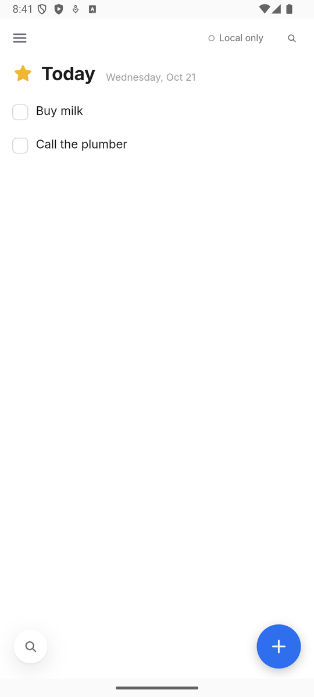
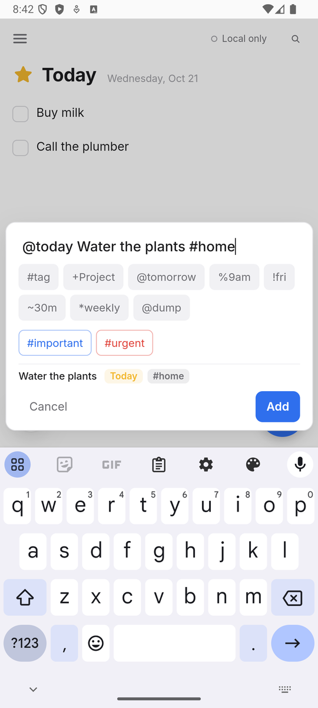
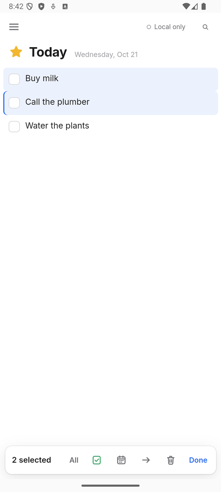

# Android app

Status: **preview, looking for testers** ([#6](https://github.com/spuder/OpenThings/issues/6)). The app is the same web code wrapped with [Capacitor](https://capacitorjs.com) 8, like the [iOS app](ios.md), plus one small Java plugin. It runs on Android 7.0 (API 24) and newer and targets Android 16 (API 36). It's tested in the Android 15 emulator; not yet on a phone.

| Today | Quick add | Multi-select |
| --- | --- | --- |
|  |  |  |

| Piece | Where | State |
| --- | --- | --- |
| App shell (WebView, `https://localhost`) | `android/`, `capacitor.config.ts` | Implemented |
| Reminder notifications scheduled with Android | `src/lib/native/capacitor.svelte.ts` | Implemented |
| Tap a notification → open the task | same | Implemented |
| `openthings://` links: add to-dos, open lists, pairing ([url-scheme.md](url-scheme.md)) | `android/app/src/main/AndroidManifest.xml` | Implemented |
| Scan the pairing QR code (Settings → Sync → Scan QR code) | `android/app/src/main/java/io/github/spuder/openthings/OpenThingsPlugin.java` | Implemented |
| Multi-select (press and hold), quick add above the keyboard | the web app | Implemented |
| Back button / gesture: closes what's open, then back to Today, then leaves the app | `src/lib/native/back.ts` | Implemented |
| Dark mode: launch screen, background and system bar icons follow the app's theme | `android/app/src/main/res/values-night`, `MainActivity.java`, `capacitor.svelte.ts` | Implemented |
| App shortcuts (press and hold the icon): New to-do, Today, Inbox, Upcoming | `android/app/src/main/res/xml/shortcuts.xml` | Implemented |
| Home screen widgets | — | Not started (a Glance widget reading a snapshot in SharedPreferences) |
| Share to OpenThings from other apps | — | Not started (an `ACTION_SEND` intent filter) |
| Google Assistant | — | Not planned for now: automation apps (Tasker, …) can open `openthings://add?…&save=1` |

## Install a test build

Every pull request and every push to `main` builds a debug APK in the **Android** workflow:

1. Open the latest run of [Android](https://github.com/spuder/OpenThings/actions/workflows/android.yml) and download the `OpenThings-android-debug` artifact (you need to be signed in to GitHub). Unzip it.
2. Copy the `.apk` to your phone and open it. Android asks you to allow installing apps from the app you opened it with (Files, Chrome…).
3. Or, with USB debugging on: `adb install OpenThings-*-android-debug.apk`.

Debug builds are signed with a throwaway key, so a build from a different run can't update this one in place: uninstall first, and your local data goes with it. Turn on sync (Settings → Sync) to keep your to-dos on your server.

## Back button

Android's back button or back gesture steps out one level at a time (`src/lib/native/back.ts`):

1. With the keyboard up, Android hides the keyboard first.
2. An open overlay (quick add, Quick Find, the command palette, a menu) closes, exactly as Escape does on a keyboard.
3. The list drawer closes.
4. The open to-do closes (its edits are saved), or a multi-selection ends.
5. In any list other than Today, back goes to Today.
6. On Today, back leaves the app. It keeps running in the background, as with the Home button.

## Reminders

Reminders are scheduled with Android's alarm manager, so they arrive with the app closed.

- **Notifications permission:** Android 13 and newer ask the first time, from Settings → Notifications → Allow notifications.
- **Exact timing:** Android 12 and newer only allow apps to set exact alarms if you turn on *Alarms & reminders* for them, and Android 14 and newer start with it off. While it's off, Android may deliver a reminder a few minutes late to save battery (in the emulator: about 1.5 minutes). Settings → Notifications → **Allow exact timing** opens that switch; reminders are rescheduled exactly when you come back.
- **While the app is open,** it plays the chime and shows the reminder itself, as on the other platforms. Android keeps the app running for a short while after you leave it, so a reminder that comes due in that window is posted as a notification straight away.
- **Force stop** (Settings → Apps → OpenThings → Force stop) deletes an app's alarms. Opening OpenThings again schedules them again.

## Build it yourself

You need [Android Studio](https://developer.android.com/studio) (its bundled JDK 21 and an Android SDK with API 36) and Node 22.

```sh
npm ci && npm run build && npx cap sync android
npx cap open android          # Android Studio: pick a device or emulator and press Run
```

Or from a terminal:

```sh
export JAVA_HOME="/Applications/Android Studio.app/Contents/jbr/Contents/Home"   # macOS; any JDK 21 works
export ANDROID_HOME="$HOME/Library/Android/sdk"
(cd android && ./gradlew assembleDebug)
adb install -r android/app/build/outputs/apk/debug/app-debug.apk
```

After web changes: `npm run build && npx cap sync android`. The version comes from `package.json` (`android/app/build.gradle`): `versionName` is the version and `versionCode` is `X*10000 + Y*100 + Z`, so `scripts/bump-version.sh` covers Android too.

## Notes

- **Origin and storage:** the page is served from `https://localhost`, Capacitor's Android default. IndexedDB (all task data) is keyed by origin, so keep it fixed. The iOS app uses `capacitor://localhost`; the two never share local data, only the sync server.
- **Native plugin:** Android registers the same `OpenThingsNative` plugin name as iOS, but implements only `scanQRCode`, with [Google's code scanner](https://developers.google.com/ml-kit/vision/barcode-scanning/code-scanner) from Play services. It shows its own camera screen and needs no camera permission. The first scan may wait while Play services downloads the scanner. The App Group methods (widgets, share inbox) are called on iOS only.
- **Icons:** `android/app/src/main/res/mipmap-*` are generated from `ios/App/App/Assets.xcassets/AppIcon.appiconset/AppIcon-1024.png` with `@capacitor/assets` (an adaptive icon on Android 8 and newer). The launch screen (`drawable/splash.xml`, the icon as a vector on the app's light or dark background) and the notification icon (`drawable/ic_stat_openthings.xml`, set in `capacitor.config.ts`) are vectors drawn for this project.

## Next

1. Test on phones from the [tester sign-up](https://docs.google.com/forms/d/e/1FAIpQLSf0Vke8v5YCE53KemDdbn5VFub2v2MIK32OaTM-B6Sf1psgVg/viewform).
2. A signed release APK on each GitHub release, then Google Play.
3. Share to OpenThings, then a home screen widget.
