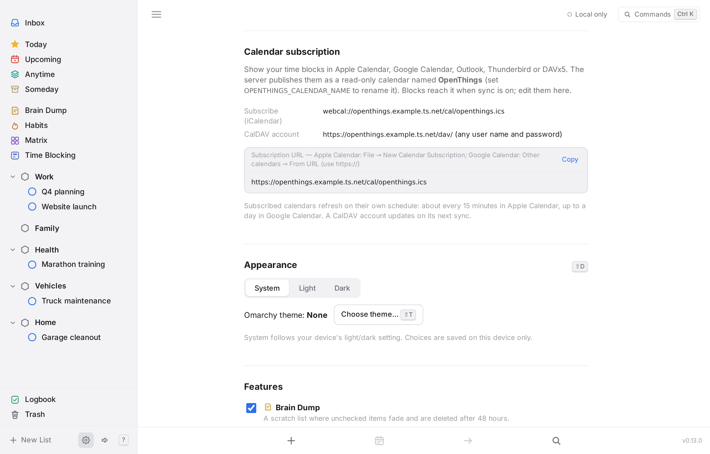

# REST API and MCP

The OpenThings server (the Docker image) offers a JSON API for scripts, Home Assistant, n8n and Shortcuts, and an MCP endpoint for AI assistants. Both read and change the same data your devices sync, and every change goes through the op log, so it reaches your devices on their next sync.

- **Base URL:** `https://openthings.<tailnet>.ts.net` (or wherever you run the container)
- **Auth:** none yet. Keep the server on your tailnet or another private network. Browser requests from other websites are refused (see [sync.md](sync.md#endpoints)).
- **Calendar:** time blocks as an iCalendar feed and a read-only CalDAV calendar, see [Calendar subscription](#calendar-subscription).
- **Dates:** "today" follows the container's `TZ`. Days are `YYYY-MM-DD`; reminders are ISO timestamps (UTC).

Settings → REST API / MCP in the app shows these with your server's address filled in.

## REST API

All bodies are JSON. Errors are `{"error": "…"}` with status 400 (bad input), 404 (unknown id or name) or 403 (origin not allowed).

### To-dos

| Method | Path | |
| --- | --- | --- |
| GET | `/api/v1/tasks?view=today` | A list: `inbox`, `today`, `week`, `upcoming`, `anytime`, `someday`, `logbook`, `dump`, `trash`, `matrix`, `all`. Narrow with `project=`, `area=`, `tag=` (names or ids; then the default view is `all`). `include_completed=1` with `all`. `limit=`. |
| GET | `/api/v1/tasks?q=dentist` | Search titles and notes (every word must match). |
| GET | `/api/v1/tasks/:id` | One to-do. |
| POST | `/api/v1/tasks` | Create. `{"text": "…"}` is parsed like quick add; or send fields (below). Fields win over the text. |
| PATCH | `/api/v1/tasks/:id` | Change fields. `null` clears a date, deadline, reminder or repeat. |
| POST | `/api/v1/tasks/:id/complete` | Check off. A repeating to-do returns `next`, its next occurrence (`null` once its COUNT or UNTIL has run out). |
| POST | `/api/v1/tasks/:id/uncomplete` | Un-check. |
| POST | `/api/v1/tasks/:id/move` | `{"project": "…"}`, `{"area": "…"}`, `{"inbox": true}` or `{"dump": true}`. Leaving the Brain Dump makes it permanent. |
| DELETE | `/api/v1/tasks/:id` | Move to the Trash (restorable for 30 days). |
| POST | `/api/v1/tasks/:id/restore` | Take it out of the Trash. |
| POST | `/api/v1/tasks/:id/checklist` | `{"title": "…"}` adds a checklist item. |
| PATCH | `/api/v1/checklist/:id` | `{"done": true}` checks an item. |

Fields for create and update:

| Field | Example | |
| --- | --- | --- |
| `text` | `"Call dentist +Health @fri %9am #phone"` | Create only. [Quick-add syntax](../README.md#quick-add-syntax). |
| `title` | `"Call dentist"` | Literal, no parsing. |
| `notes` | `"Ask about x-rays"` | |
| `when` | `today`, `tonight`, `tomorrow`, `fri`, `next-week`, `in3d`, `someday`, `anytime`, `inbox`, `2026-11-02` | `inbox` on update also clears the project and area. |
| `deadline` | `fri`, `2026-11-02` | |
| `reminder` | `9am`, `fri 9am`, `in 30m`, ISO timestamp | A bare time lands on the to-do's day. |
| `repeat` | `daily`, `weekly`, `weekdays`, `2w`, `mon,thu`, `1st,15th`, `last-fri`, `FREQ=MONTHLY;BYDAY=2TU` | Quick-add repeat words or an RFC 5545 RRULE (FREQ, INTERVAL, BYDAY, BYMONTHDAY, BYMONTH, BYSETPOS, COUNT, UNTIL). `null` stops repeating. |
| `project`, `area` | `"Health"` | An existing one, by name or id. (Quick-add `+Name` creates a project, as in the app.) |
| `tags` | `["phone"]` | Replaces all tags. Update also takes `add_tags` and `remove_tags`. |
| `urgent`, `important` | `true` | Eisenhower flags. |
| `estimate_min` | `30` | |
| `dump`, `dump_section` | `true`, `"Ideas"` | Create only: put it in the Brain Dump. |

A to-do in responses is the stored row plus `tags` (names), `project` and `area` (names), `checklist` and `repeat` (a description). Lists also carry `group`: `evening` in Today, the date in `upcoming` and `week`, the quadrant in `matrix`.

### Projects, areas, tags

| Method | Path | |
| --- | --- | --- |
| GET | `/api/v1/projects` | With area name and open to-do count. |
| POST | `/api/v1/projects` | `{"name": "…", "area": "…"}` |
| GET | `/api/v1/areas` | |
| POST | `/api/v1/areas` | `{"name": "…"}` |
| GET | `/api/v1/tags` | With open to-do count. |

### Habits and time tracking

| Method | Path | |
| --- | --- | --- |
| GET | `/api/v1/habits` | With today's check-in, streak, schedule and the last two weeks. |
| POST | `/api/v1/habits` | `{"text": "Gym 4x 60d"}`: trailing words set the schedule and challenge, as in the app. |
| POST | `/api/v1/habits/:id/check` | Check in today, or `{"day": "yesterday"}`. `:id` may be the habit's name. |
| DELETE | `/api/v1/habits/:id/check?day=…` | Remove a check-in. |
| GET | `/api/v1/timers` | The running timer, or `null`. |
| POST | `/api/v1/timers/start` | `{"task_id": "…"}`. Stops any running timer first. |
| POST | `/api/v1/timers/stop` | |

### Examples

```sh
# Add a to-do with quick-add syntax
curl -X POST https://openthings.example.ts.net/api/v1/tasks \
  -H 'content-type: application/json' \
  -d '{"text": "Call dentist +Health @fri %9am #phone"}'

# Today's list
curl 'https://openthings.example.ts.net/api/v1/tasks?view=today'

# Check off
curl -X POST https://openthings.example.ts.net/api/v1/tasks/<id>/complete
```

## MCP

`POST /mcp` speaks the Model Context Protocol over Streamable HTTP (stateless JSON responses; MCP 2024-11-05 through 2025-11-25).

```sh
claude mcp add --transport http openthings https://openthings.example.ts.net/mcp
```

Clients that only run local commands can bridge with `npx -y mcp-remote https://openthings.example.ts.net/mcp`.

| Tool | |
| --- | --- |
| `list_tasks` | A list (today by default), optionally for a project, area or tag |
| `search_tasks` | Find to-dos by words in the title or notes |
| `get_task` | One to-do with notes, tags and checklist |
| `add_task` | Create with quick-add syntax, plus optional fields |
| `update_task` | Title, notes, when, deadline, reminder, repeat, tags, flags |
| `complete_task` | Check off (`undo` to un-check); repeating to-dos schedule the next one |
| `move_task` | To a project, area, the Inbox or the Brain Dump |
| `delete_task` | Move to the Trash (`restore` to take it back) |
| `brain_dump` | Capture into the Brain Dump |
| `add_checklist_item`, `check_checklist_item` | Checklists |
| `list_projects`, `add_project`, `add_area` | Areas, projects and tags (`add_area` returns an existing area with the same name) |
| `list_habits`, `check_habit` | Habits and check-ins |
| `start_timer`, `stop_timer`, `current_timer` | Time tracking |

Tool results are compact JSON: empty fields are left out.

## Calendar subscription

The server publishes your [time blocks](../README.md#features) as a read-only calendar so other calendar apps can show them. It's named **OpenThings**; set `OPENTHINGS_CALENDAR_NAME` to change that. Blocks reach the server when a device syncs, and changes show up in subscribed calendars on their next refresh. Edit blocks in OpenThings: the calendar refuses writes.



| | URL | Use it in |
| --- | --- | --- |
| iCalendar feed | `https://<server>/cal/openthings.ics` (or `webcal://…`) | Apple Calendar (File → New Calendar Subscription), Google Calendar (Other calendars → From URL), Outlook (Add calendar → Subscribe from web), any app that subscribes to `.ics` |
| CalDAV | `https://<server>/dav/` | Apple Calendar (Add Account → Other CalDAV Account → Manual), Thunderbird, DAVx5 on Android. Any user name and password works: there's no login yet. |
| Discovery | `https://<server>/.well-known/caldav` | Redirects to `/dav/`, so clients that only ask for the server find it. |

- **Each block is one event.** The event is titled like the block on the calendar, such as "Change oil". Its description is the full path, "Vehicles › Truck maintenance › Change oil", and the area is its category. Its UID is `<block id>@openthings`, so edits update the same event instead of adding new ones.
- **Times are floating local times,** as in the app, so a 9:00 block shows at 9:00. The feed also names the server's `TZ` (`X-WR-TIMEZONE`), which Google Calendar uses.
- **Refresh rate:** the feed asks subscribers to refresh every 15 minutes. Apple Calendar mostly honors that. Google Calendar decides for itself and can take up to a day.
- **Google Calendar needs a public URL.** Google fetches subscribed feeds from its own servers, so it can't reach a server that's only on your tailnet. Apple Calendar, Outlook on the desktop, Thunderbird and DAVx5 fetch from your device, so a tailnet address works for them.
- **The CalDAV support is a read-only subset** (RFC 4791):
  - `PROPFIND` on the principal, calendar home and calendar at depth 0 or 1.
  - `REPORT` with `calendar-multiget` and `calendar-query`, including `time-range`.
  - `GET` of one event.
  - ETags and `getctag` for change detection.
  - `PUT`, `DELETE` and `PROPPATCH` return 403.

